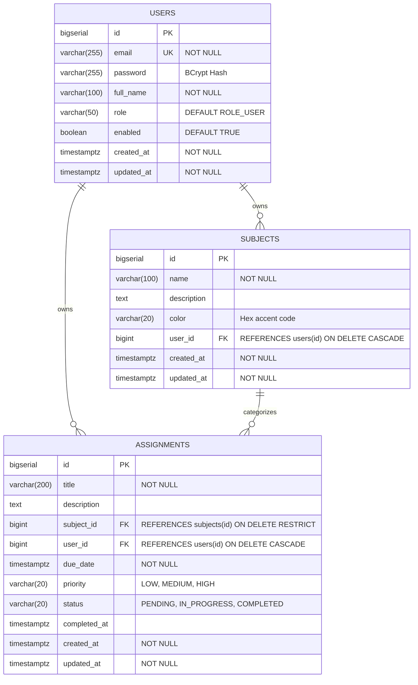

# CampusFlow — Student Academic & Deadline Tracker

[](https://openjdk.org/projects/jdk/21/)
[](https://spring.io/projects/spring-boot)
[](https://www.postgresql.org/)
[](#10-automated-tests)

A full-stack web application engineered for college students and academic learners to organize course subjects, track deadlines, monitor priorities, and visualize academic productivity.

- **GitHub Repository**: [https://github.com/virajgandhi2406-collab/CampusFlow](https://github.com/virajgandhi2406-collab/CampusFlow)
- **Live Public URL**: [https://solid-mirrors-stay.loca.lt](https://solid-mirrors-stay.loca.lt) *(Tunnel Endpoint Verification Password: `103.35.133.180`)*

---

## 1. Problem Statement

College students frequently juggle multiple demanding subjects, unpredictable deadlines, varying priority levels, and scattered syllabi across disparate tools. Without a structured, unified tracking system, students face deadline anxiety, missed coursework, and poor visibility into their weekly academic velocity. 

**CampusFlow** solves this challenge by providing a centralized academic hub that combines:
- Isolated personal workspace per student.
- Subject organization with safety policies preventing accidental data loss.
- Multi-dimensional assignment filtering, title searching, and sorting.
- Real-time, database-driven dashboard metrics (no hardcoded counters).
- Weekly productivity insights with day-by-day task completion visualization.

---

## 2. Key Features

- **Authentication & User Isolation**:
  - Secure account registration with input validation.
  - Session-based authentication using Spring Security 6.
  - BCrypt password hashing (work factor 12).
  - Cross-Site Request Forgery (CSRF) protection on all state-changing endpoints.
  - Server-side Insecure Direct Object Reference (IDOR) defense ensuring users can only view, edit, or delete their own coursework and subjects.
- **Academic Dashboard**:
  - Derived live metrics: Total Coursework, In-Progress, Pending, Completed, Overdue, and Upcoming Deadlines (within 7 days).
  - Calculated completion percentage (`(completed / total) * 100%`).
  - Urgent alerts panel highlighting overdue assignments.
  - Purpose-built empty state onboarding for new student accounts.
- **Assignment Management**:
  - Full CRUD workflows: Create, Read, Edit, and Delete.
  - Priority levels: `LOW`, `MEDIUM`, `HIGH`.
  - Status progression: `PENDING`, `IN_PROGRESS`, `COMPLETED`.
  - One-click completion toggle with automatic `completed_at` UTC timestamping.
  - Multi-criteria filtering by Subject, Status, Priority, and text search by Title.
  - Sorting by due date (ascending/descending), priority level, or title.
  - Server-side pagination preserving all active filter parameters.
  - Visual badges for overdue deadlines and assignments due within 7 days.
- **Subject / Coursework Management**:
  - Create and update course names, syllabus descriptions, and color accents.
  - Coursework overview listing all assignments under each subject.
  - **Safe Deletion Policy**: Subjects containing existing coursework cannot be deleted until associated assignments are reassigned or deleted, preventing accidental academic record loss.
- **Productivity Insights**:
  - Weekly productivity summary showing assignments completed this week, pending due this week, and overdue count.
  - Transparent mathematical definitions for all metrics.
  - Dynamic Chart.js bar chart displaying day-by-day completions across the Monday–Sunday cycle.
- **Responsive & Accessible UI**:
  - Built with semantic HTML5, modern CSS3 custom properties, and Vanilla JavaScript.
  - Mobile-responsive navigation drawer.
  - Accessible HTML5 `<dialog>` confirmation modals for destructive deletion actions.
  - Distinct status and priority badge indicators.

---

## 3. Technology Stack

### Backend
- **Language**: Java 21 (LTS)
- **Framework**: Spring Boot 3.3.4
- **Security**: Spring Security 6 (Session auth, BCrypt, CSRF)
- **Persistence**: Spring Data JPA, Hibernate 6
- **Database**: PostgreSQL 16
- **Database Migrations**: Flyway Core & Flyway Database PostgreSQL
- **Validation**: Bean Validation (Hibernate Validator)
- **Testing**: JUnit 5, Mockito, Spring Boot Starter Test, Spring Security Test, H2 (PostgreSQL compatibility mode for fast test execution)

### Frontend
- **Templating**: Thymeleaf with Spring Security 6 dialect
- **Structure**: HTML5 Semantic markup
- **Styling**: Modern Vanilla CSS3 (Custom properties, Flexbox, Grid, Glassmorphic accents)
- **Interactivity**: Vanilla JavaScript (ES6+)
- **Data Visualization**: Chart.js 4.4.x (Productivity trend charts)

---

## 4. Architecture & Folder Structure

CampusFlow follows a conventional, layered Spring Boot architecture:

```
campusflow/
├── docker-compose.yml              # Local PostgreSQL 16 service definition
├── .env.example                    # Environment variable configuration template
├── .gitignore                      # Git exclusion rules
├── pom.xml                         # Maven dependencies & build configuration
├── run_mvn.cmd                     # Cross-platform Maven runner script
├── README.md                       # Documentation & deployment guide
├── src/
│   ├── main/
│   │   ├── java/com/campusflow/
│   │   │   ├── CampusFlowApplication.java      # Application entrypoint (UTC timezone configured)
│   │   │   ├── config/                         # Security & Web MVC configurations
│   │   │   │   ├── SecurityConfig.java
│   │   │   │   └── WebMvcConfig.java
│   │   │   ├── controller/                     # Web MVC Controllers
│   │   │   │   ├── AuthController.java
│   │   │   │   ├── DashboardController.java
│   │   │   │   ├── AssignmentController.java
│   │   │   │   ├── SubjectController.java
│   │   │   │   ├── InsightsController.java
│   │   │   │   └── CustomErrorController.java
│   │   │   ├── dto/                            # Data Transfer Objects & Validation
│   │   │   │   ├── UserRegistrationDto.java
│   │   │   │   ├── SubjectDto.java
│   │   │   │   ├── AssignmentDto.java
│   │   │   │   ├── AssignmentFilterDto.java
│   │   │   │   ├── DashboardMetricsDto.java
│   │   │   │   └── WeeklyStatsDto.java
│   │   │   ├── entity/                         # JPA Entities & Enums
│   │   │   │   ├── User.java
│   │   │   │   ├── Subject.java
│   │   │   │   ├── Assignment.java
│   │   │   │   ├── Priority.java
│   │   │   │   └── AssignmentStatus.java
│   │   │   ├── exception/                      # Exception Handling & ControllerAdvice
│   │   │   │   ├── ResourceNotFoundException.java
│   │   │   │   ├── AccessDeniedException.java
│   │   │   │   ├── DuplicateEmailException.java
│   │   │   │   ├── SubjectConflictException.java
│   │   │   │   └── GlobalExceptionHandler.java
│   │   │   ├── repository/                     # Spring Data JPA Repositories & Specifications
│   │   │   │   ├── UserRepository.java
│   │   │   │   ├── SubjectRepository.java
│   │   │   │   └── AssignmentRepository.java
│   │   │   └── service/                        # Business Logic & Implementations
│   │   │       ├── SecurityService.java
│   │   │       ├── UserService.java
│   │   │       ├── SubjectService.java
│   │   │       ├── AssignmentService.java
│   │   │       ├── DashboardService.java
│   │   │       └── impl/
│   │   │           ├── SecurityServiceImpl.java
│   │   │           ├── UserServiceImpl.java
│   │   │           ├── SubjectServiceImpl.java
│   │   │           ├── AssignmentServiceImpl.java
│   │   │           ├── DashboardServiceImpl.java
│   │   │           └── UserDetailsServiceImpl.java
│   │   └── resources/
│   │       ├── application.yml                 # Production application configuration
│   │       ├── application-test.yml            # Test profile configuration (H2 in PostgreSQL mode)
│   │       ├── db/migration/                   # Flyway Migration Scripts
│   │       │   ├── V1__init_schema.sql         # Base tables, foreign keys, and constraints
│   │       │   └── V2__add_indexes.sql         # Performance query indexes
│   │       ├── static/                         # Static assets
│   │       │   ├── css/styles.css              # Custom responsive stylesheet
│   │       │   └── js/
│   │       │       ├── app.js                  # Modals, mobile drawer, alert dismissal
│   │       │       └── chart-config.js         # Chart.js initialization
│   │       └── templates/                      # Thymeleaf HTML Templates
│   │           ├── fragments/                  # Reusable components (head, sidebar, topbar, alerts, footer)
│   │           ├── auth/                       # Login and registration templates
│   │           ├── dashboard/                  # Academic dashboard view
│   │           ├── assignments/                # Assignment list, form, and detail views
│   │           ├── subjects/                   # Subject list, form, and detail views
│   │           ├── insights/                   # Productivity insights view
│   │           └── error/                      # Custom 403, 404, 500 error views
│   └── test/
│       └── java/com/campusflow/
│           ├── CampusFlowApplicationTests.java
│           ├── controller/
│           │   ├── AuthControllerTest.java
│           │   ├── DashboardControllerTest.java
│           │   ├── AssignmentControllerTest.java
│           │   ├── SubjectControllerTest.java
│           │   └── InsightsControllerTest.java
│           ├── dto/
│           │   └── ValidationTest.java
│           ├── integration/
│           │   └── EndToEndWorkflowTest.java
│           ├── security/
│           │   └── SecurityAndIsolationTest.java
│           └── service/
│               ├── UserServiceTest.java
│               ├── SubjectServiceTest.java
│               ├── AssignmentServiceTest.java
│               └── DashboardServiceTest.java
```

---

## 5. Database Schema & Entity Relationships

### Entity-Relationship Diagram (ERD)



### Database Integrity Rules & Constraints
1. **User Unique Email**: Case-insensitive uniqueness enforced on `users(email)`.
2. **Per-User Subject Uniqueness**: Composite unique constraint `CONSTRAINT uq_user_subject_name UNIQUE (user_id, name)` ensures a student cannot create duplicate subject names.
3. **Safe Deletion Foreign Key**: `assignments(subject_id)` references `subjects(id)` with `ON DELETE RESTRICT`. A subject cannot be deleted while child assignments remain.
4. **Cascade User Deletion**: Deleting a user account cascades to their associated subjects and assignments cleanly.
5. **UTC Timestamping**: All timestamps are stored as `TIMESTAMP WITH TIME ZONE` in UTC.

---

## 6. Installation Prerequisites

- **Java Development Kit (JDK)**: Java 21 or higher
- **Maven**: Version 3.8+ (or use the provided `run_mvn.cmd` script)
- **Database**: PostgreSQL 16+ or Docker Compose

---

## 7. Environment Setup & Configuration

1. Copy `.env.example` to `.env`:
   ```bash
   cp .env.example .env
   ```

2. Configure environment variables (or export them in your shell):
   ```ini
   PORT=8080
   SPRING_DATASOURCE_URL=jdbc:postgresql://localhost:5432/campusflow_db
   SPRING_DATASOURCE_USERNAME=postgres
   SPRING_DATASOURCE_PASSWORD=postgres
   TZ=UTC
   ```

---

## 8. Database Startup

### Option A: Using Docker Compose (Recommended)
Start the PostgreSQL 16 container:
```bash
docker compose up -d
```
To stop the database:
```bash
docker compose down
```

### Option B: Using Local PostgreSQL
Ensure PostgreSQL is running locally and create the database:
```sql
CREATE DATABASE campusflow_db;
```

When the application starts, **Flyway** automatically runs migrations `V1__init_schema.sql` and `V2__add_indexes.sql` to prepare the database schema and indexes.

---

## 9. Application Startup Commands

### Running Locally with Maven
```bash
./run_mvn.cmd spring-boot:run
```
*(On Linux/macOS with standard Maven installed: `mvn spring-boot:run`)*

Once started, open your browser and navigate to:
```
http://localhost:8080
```

---

## 10. Automated Tests

The test suite runs against an isolated, in-memory H2 database running in **PostgreSQL compatibility mode**, ensuring full automated testing without requiring an external PostgreSQL instance.

Run all tests:
```bash
./run_mvn.cmd test
```

### Test Coverage Highlights (51 Tests, 0 Failures, 0 Errors)
- **`UserServiceTest`**: Registration validation, BCrypt password hashing, duplicate email detection, and password confirmation checks.
- **`SubjectServiceTest`**: Subject CRUD, duplicate name constraint checks, safe deletion blocking when assignments exist, and IDOR protection.
- **`AssignmentServiceTest`**: Assignment CRUD, subject ownership checks, status transitions, timestamping on completion, and overdue deadline logic.
- **`DashboardServiceTest`**: Verification of real DB metric calculations, completion rate rounding, 0-division guards, and weekly statistical aggregation.
- **`ValidationTest`**: Bean Validation constraint checks on `UserRegistrationDto`, `AssignmentDto`, `SubjectDto`, and `AssignmentFilterDto` boundary checks.
- **`AuthControllerTest`**: MVC test checking login view, registration view, bean validation feedback, and unauthorized redirects.
- **`DashboardControllerTest`**: MVC test checking root URL `/` redirect to `/dashboard`, model attribute hydration, and view rendering.
- **`AssignmentControllerTest`**: MVC test checking assignment listing with filters, creation, detail overview, completion toggling, and deletion.
- **`SubjectControllerTest`**: MVC test checking subject listing, creation, conflict feedback, detail view, and safe deletion.
- **`InsightsControllerTest`**: MVC test verifying weekly productivity calculations, metric models, and chart configuration data attributes.
- **`SecurityAndIsolationTest`**: Full security integration test verifying CSRF enforcement, session protection, and strict user data isolation (User A cannot view, update, or delete User B's assignments or subjects).
- **`EndToEndWorkflowTest`**: Comprehensive student lifecycle integration test verifying registration with BCrypt hashing, duplicate registration rejection, subject and assignment creation, metrics calculation on the dashboard, completion status toggling with timestamps, weekly velocity insights, safe deletion policy enforcement (deleting subject blocked when assignments exist), assignment deletion, and safe subject removal.

---

## 11. Application Routes Summary

| HTTP Method | Route | Description | Auth Required |
|:---|:---|:---|:---:|
| `GET` | `/login` | Sign-in page | No |
| `POST` | `/login` | Process sign-in | No |
| `GET` | `/register` | Registration page | No |
| `POST` | `/register` | Process registration | No |
| `POST` | `/logout` | Terminate session and sign out | Yes |
| `GET` | `/` | Root path (redirects to `/dashboard`) | Yes |
| `GET` | `/dashboard` | Student dashboard with live metrics & overdue alerts | Yes |
| `GET` | `/assignments` | Coursework list with search, filter, sort & pagination | Yes |
| `GET` | `/assignments/new` | New assignment form | Yes |
| `POST` | `/assignments` | Create assignment | Yes |
| `GET` | `/assignments/{id}` | Assignment overview & metadata | Yes |
| `GET` | `/assignments/{id}/edit` | Edit assignment form | Yes |
| `POST` | `/assignments/{id}/edit` | Update assignment | Yes |
| `POST` | `/assignments/{id}/delete` | Delete assignment | Yes |
| `POST` | `/assignments/{id}/toggle-complete` | Toggle assignment between Completed and Pending | Yes |
| `GET` | `/subjects` | Subject cards view with assignment counts | Yes |
| `GET` | `/subjects/new` | New subject form | Yes |
| `POST` | `/subjects` | Create subject | Yes |
| `GET` | `/subjects/{id}` | Subject detail view & associated coursework list | Yes |
| `GET` | `/subjects/{id}/edit` | Edit subject form | Yes |
| `POST` | `/subjects/{id}/edit` | Update subject | Yes |
| `POST` | `/subjects/{id}/delete` | Safely delete subject (blocked if coursework exists) | Yes |
| `GET` | `/insights` | Weekly productivity summary and Chart.js distribution | Yes |

---

## 12. Security Architecture

1. **Authentication**: Form-based authentication with `UserDetailsService` and `DaoAuthenticationProvider`.
2. **Password Storage**: Passwords are never stored in plaintext; hashed with `BCryptPasswordEncoder(12)`.
3. **Session Fixation Defense**: Sessions are migrated upon authentication (`sessionFixation().migrateSession()`).
4. **CSRF Protection**: All state-modifying requests (`POST`, `PUT`, `DELETE`) require a valid CSRF token generated per session.
5. **IDOR & Data Isolation**: Every service method fetching or modifying an entity verifies that the entity's owner ID strictly matches the authenticated principal's ID:
   ```java
   if (!assignment.getUser().getId().equals(currentUserId)) {
       throw new AccessDeniedException("You do not have permission to access this assignment");
   }
   ```
6. **Error Masking**: Production errors do not disclose stack traces or sensitive database structure. Custom 403, 404, and 500 pages inform users gracefully.

---

## 13. Capturing Genuine Screenshots

To capture genuine screenshots for your portfolio or documentation:
1. Start the PostgreSQL database via Docker Compose (`docker compose up -d`).
2. Launch the application: `./run_mvn.cmd spring-boot:run`.
3. Open `http://localhost:8080/register` in your browser and register a student account.
4. Add 3–4 subjects (e.g. *Computer Networks*, *Machine Learning*, *Database Systems*).
5. Add several assignments with various due dates (some upcoming within 7 days, some completed, and some past due to showcase overdue alerts).
6. Capture screenshots of:
   - **Dashboard**: `http://localhost:8080/dashboard` (Metrics, overdue warning, upcoming deadlines)
   - **Assignments List**: `http://localhost:8080/assignments` (Search, filter by subject, badges, pagination)
   - **Productivity Insights**: `http://localhost:8080/insights` (Weekly metrics, Chart.js completion distribution)
   - **Subjects Overview**: `http://localhost:8080/subjects` (Course cards with color accents and safe deletion notes)
7. Place your images in `docs/screenshots/` and link them in this README.

---

## 14. Known Limitations

- **Email Verification**: User registration activates accounts immediately without requiring SMTP email confirmation.
- **Calendar Export**: Assignments do not yet export to iCalendar (`.ics`) format for Google Calendar / Apple Calendar sync.
- **File Attachments**: Assignment descriptions support text notes and links; binary file uploads (PDF/DOCX) are not currently stored.

---

## 15. Future Enhancements

- **Calendar Sync**: `.ics` subscription URL to sync assignment deadlines directly into Google Calendar or Outlook.
- **Email & Push Reminders**: Automated notification service 24 hours and 3 hours prior to assignment deadlines.
- **Kanban Board View**: Drag-and-drop board interface for `PENDING` -> `IN_PROGRESS` -> `COMPLETED`.
- **Study Timer / Pomodoro**: Integrated session timer logging study time directly against subjects.

---

## 16. License

This project is developed for educational and portfolio demonstration purposes. All rights reserved.
